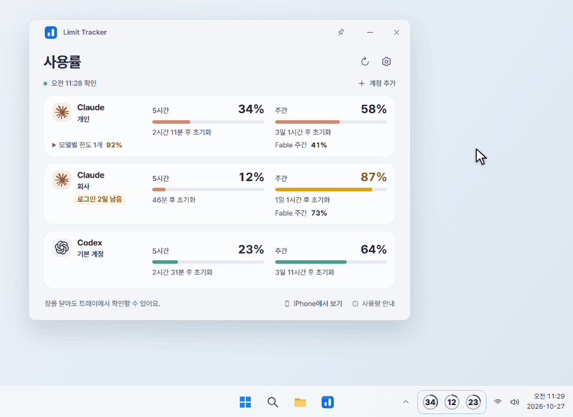
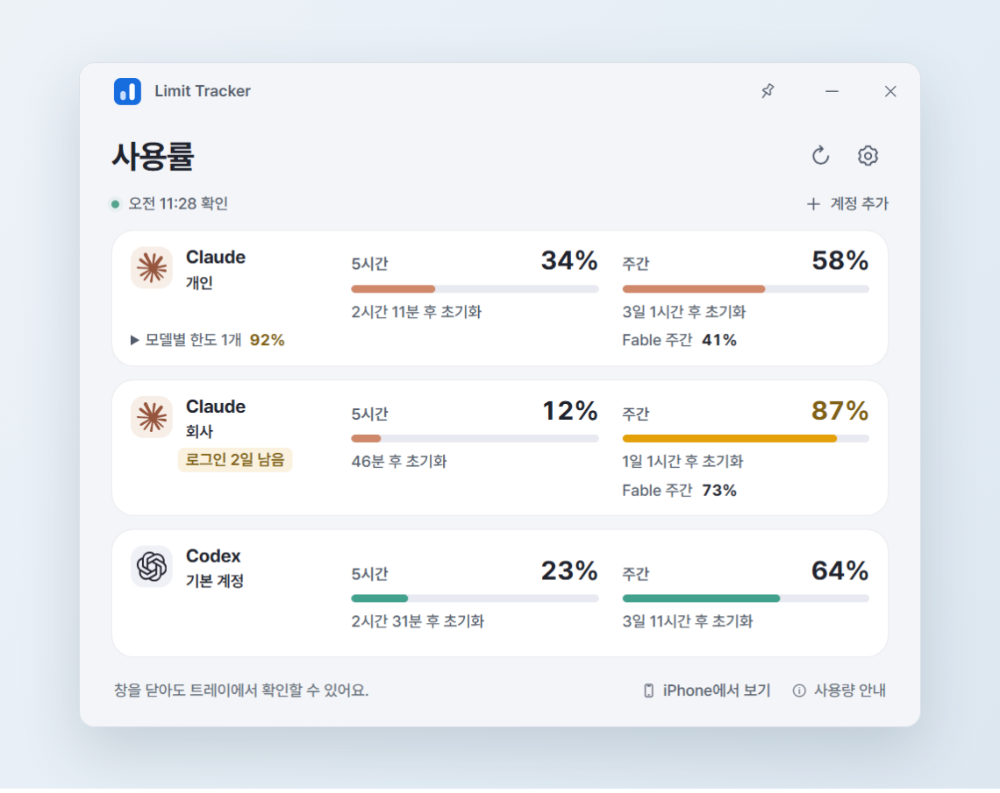
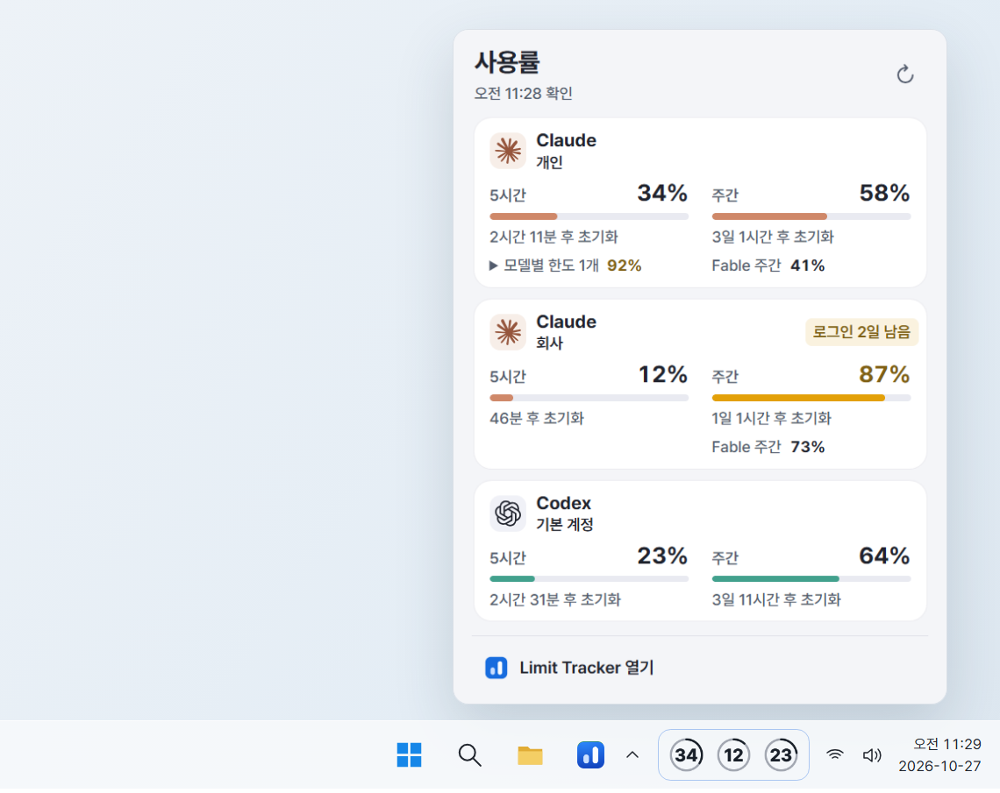
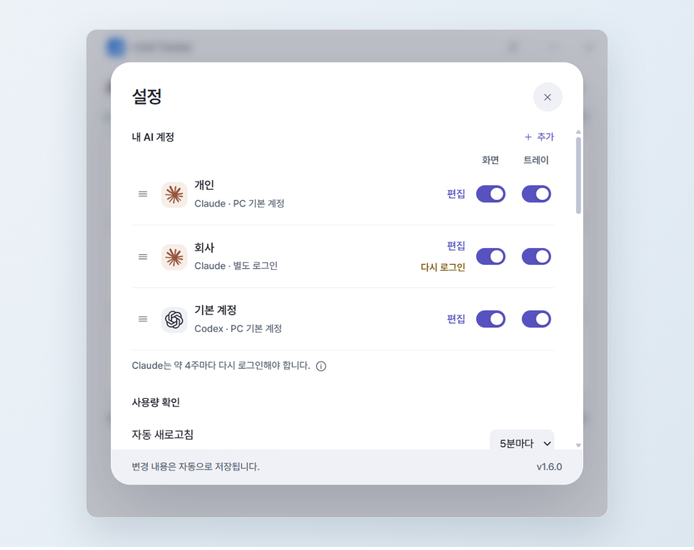
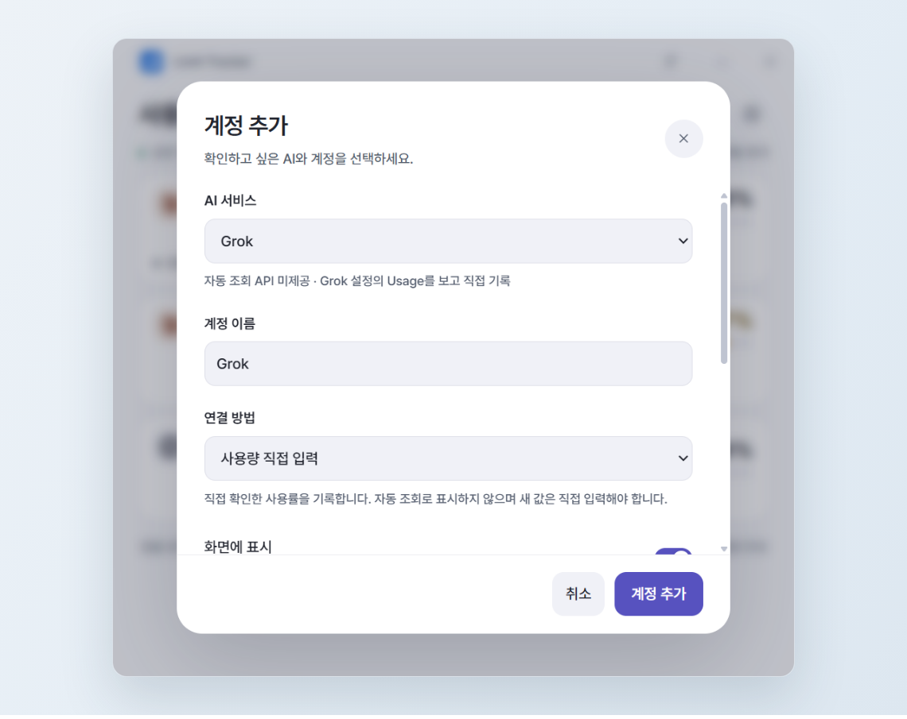
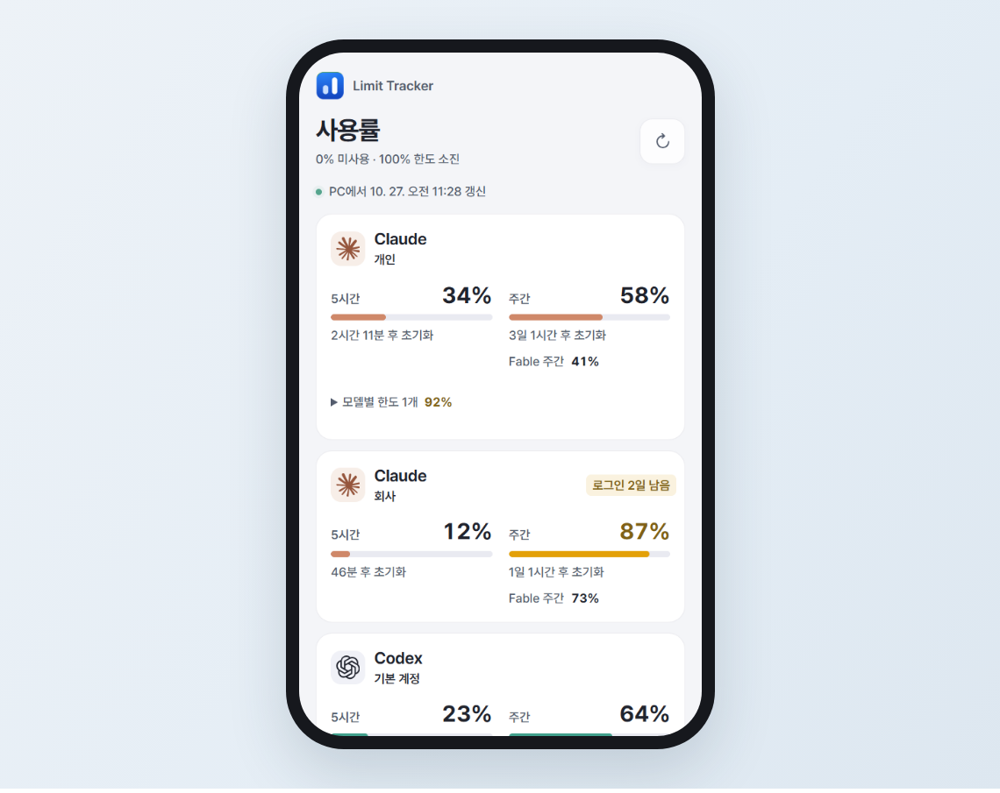
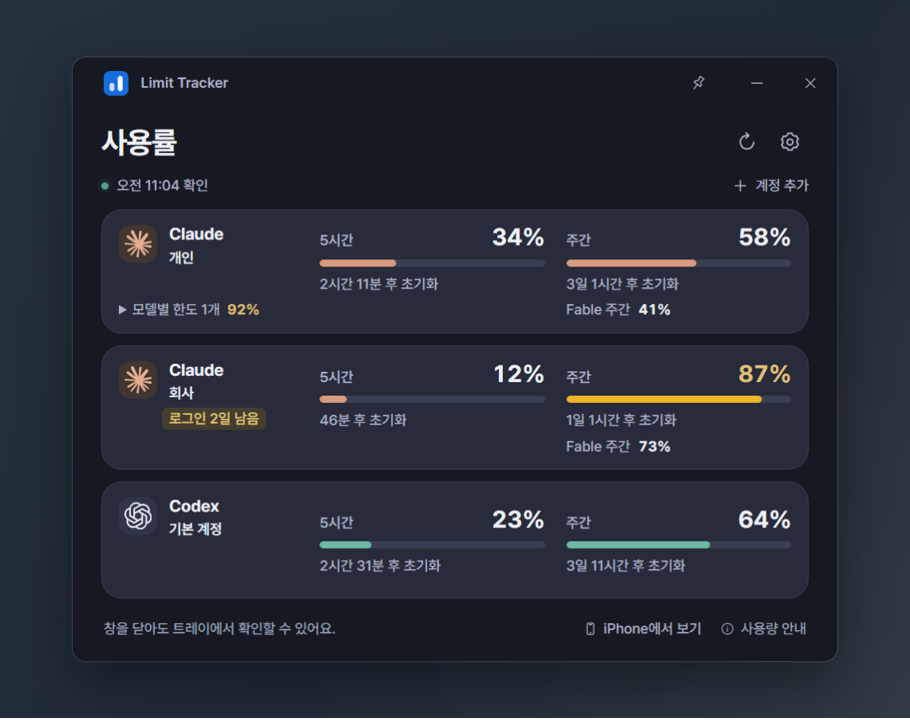

<div align="center">


# Limit Tracker

AI 사용량, 늘 보이는 곳에.<br>계정별 사용률을 작업 표시줄에 띄워 둬요. 클릭하지 않아도 보여요.

[English](README.md) · **한국어**

[**Windows용 내려받기**](https://github.com/nowsummer/Limit-Tracker/releases/latest) · [버전 기록](https://github.com/nowsummer/Limit-Tracker/releases) · [보안](SECURITY.ko.md)



</div>

## 만든 이유

Claude·Codex 한도가 얼마나 남았는지 보려고 사용량 페이지를 수시로 열어 봤어요. 그래서 계정마다 사용률을 작업 표시줄에 띄워 두는 앱을 만들었어요.

- **늘 보이게** — 계정마다 사용률 숫자와 원형 게이지가 트레이에 떠 있어요.
- **여러 계정도** — Claude·Codex는 계정을 여럿 추가해도 모두 자동으로 확인해요. Gemini·Grok 같은 다른 AI는 직접 입력해요.
- **놓치지 않게** — 사용률이 80%, 95%에 닿을 때와 한도가 초기화될 때 알려 줘요.
- **내 PC에서만** — 별도 서버도, 회원 가입도, 사용 통계 수집도 없어요. 인터넷으로는 AI 서비스와 업데이트용 GitHub에만 연결해요.

## 기능

| | |
|---|---|
| **작업 표시줄** | 계정마다 사용률 숫자와 원형 게이지 · 트레이에 띄울 계정 고르기 |
| **메인 화면** | 5시간·주간 한도를 나란히 · 초기화까지 남은 시간 · 모델별 한도 · 80%부터 Codex 크레딧·사용량 재설정 표시 |
| **팝업** | 트레이 아이콘을 눌러 현재·주간 한도 보기 · 새로고침 · 「Limit Tracker 열기」 |
| **알림** | 사용률 80%·95% · 한도 초기화 · Claude 로그인 기한 하루 전 |
| **iPhone** | 켜면 같은 네트워크에서 보는 읽기 전용 페이지 · 홈 화면에 추가 · Scriptable 위젯 |
| **편의** | 계정 순서는 끌어서 바꾸기 · 한국어·영어 · 라이트·다크 모드 · 「Windows 시작 시 실행」 · 「항상 위에 표시」 |

## 화면

<table>
  <tr>
    <td width="50%"></td>
    <td width="50%"></td>
  </tr>
  <tr><td align="center">메인 화면</td><td align="center">트레이 팝업</td></tr>
  <tr>
    <td></td>
    <td></td>
  </tr>
  <tr><td align="center">설정</td><td align="center">계정 추가</td></tr>
  <tr>
    <td></td>
    <td></td>
  </tr>
  <tr><td align="center">iPhone</td><td align="center">다크 모드</td></tr>
</table>

<sub>앱 창은 예시 계정으로 찍은 실제 화면이고, 주변의 바탕 화면·작업 표시줄·휴대폰 테두리는 그림이에요.</sub>

## 설치

1. [최신 릴리스](https://github.com/nowsummer/Limit-Tracker/releases/latest)에서 `Limit-Tracker-<버전>.exe`를 내려받아 실행하세요. 내 Windows 계정에만 설치돼서 관리자 권한은 필요 없고, 설치가 끝나면 바로 열려요.
2. 처음 열면 이 PC에 로그인된 Claude Code·Codex 계정(「기본 계정」)으로 바로 조회해요. Claude 자동 조회를 멈추려면 그 Claude 계정을 지우고 「사용량 직접 입력」으로 다시 추가하세요([이유](#작동-방식)). 다른 계정은 「계정 추가」에서 「별도 계정으로 로그인」이나 「사용량 직접 입력」으로 더할 수 있어요.
3. 최신 버전은 알아서 내려받아지고, 설정 → 정보의 「지금 다시 시작해 적용」이나 트레이 메뉴의 「<버전> 업데이트 설치 후 다시 시작」을 누를 때만 설치돼요.

> [!NOTE]
> 코드 서명이 없는 설치 파일이라 Windows SmartScreen이나 스마트 앱 컨트롤이 처음에 경고하거나 막을 수 있어요. Windows x64 전용이에요.

앱을 지워도 설정과 「별도 로그인」 계정의 로그인 정보는 남아요. 모두 지우는 방법은 [보안 문서](SECURITY.ko.md)에 있어요.

## 작동 방식

- **Claude(비공식)** — 이 PC에 저장된 Claude Code 로그인으로 사용량을 묻고, 로그인을 갱신하면 그 파일에 다시 써요. 요청에는 Claude Code 식별값을 붙여 보내요. Anthropic [정책](https://code.claude.com/docs/en/legal-and-compliance)은 제3자 앱이 Free·Pro·Max 로그인을 이렇게 쓰는 걸 허용하지 않고, 예고 없이 조치할 수 있다고 밝히고 있어요. 그래서 Claude 계정이 제한될 수 있어요. Claude를 직접 입력으로 쓰면 이 걱정이 없어요.
- **Codex** — OpenAI가 문서로 공개한 [app-server](https://learn.chatgpt.com/docs/app-server) 방식으로 이 PC의 Codex CLI를 실행해 한도를 받아 와요. Codex 로그인 파일은 읽지 않아요.
- **Gemini·Grok·그 밖의 AI** — 직접 입력해요. Gemini는 Google [Gemini CLI 약관](https://www.geminicli.com/docs/resources/tos-privacy)이 다른 앱에서 그 로그인을 쓰지 못하게 해서 자동으로 확인하지 않아요.

사용 통계는 수집하지 않아요. 앱이 읽고 쓰는 파일, 실행하는 프로그램, 연결하는 주소는 모두 [보안 문서](SECURITY.ko.md)에 있어요.

## 소스로 빌드

```powershell
git clone https://github.com/nowsummer/Limit-Tracker.git
cd Limit-Tracker
npm ci
npm test
npm start        # 소스로 실행
npm run dist     # 서명 없는 설치 파일(dist\)
```

Windows x64, Git, Node.js 22.12 이상이 필요해요.

직접 빌드해 설치한 앱도 이 저장소의 새 릴리스를 내려받아요. 「지금 다시 시작해 적용」을 누르면 이 저장소에 공개된 버전으로 바뀌어요. 내 빌드를 계속 쓰려면 설정의 「새 버전 자동 확인」을 끄세요.

## 라이선스

[MIT](LICENSE). 글꼴과 서비스 로고는 각자의 라이선스와 상표를 따라요([안내](docs/licenses/THIRD-PARTY.txt), [로고](assets/brands/NOTICE.md)). Anthropic·OpenAI·Google·xAI와 관계없는 개인 프로젝트예요.

**Jaeha Lee**가 만들었어요. 버그와 아이디어는 [GitHub Issues](https://github.com/nowsummer/Limit-Tracker/issues)에, 보안 문제는 [보안 문서](SECURITY.ko.md)에 적힌 방법으로 알려 주세요. 그 밖의 문의는 [limittracker.app@gmail.com](mailto:limittracker.app@gmail.com)으로 받아요. 비밀번호와 토큰은 빼고 보내 주세요.
