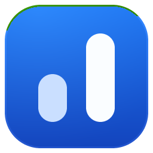
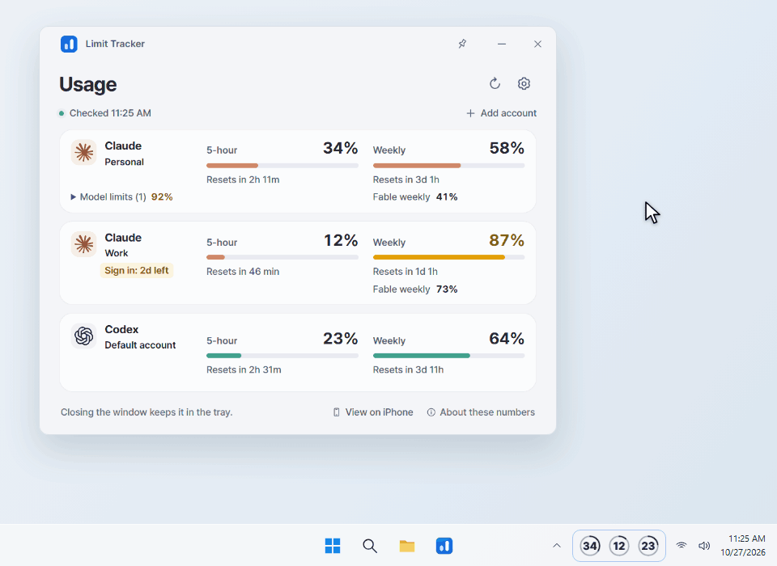
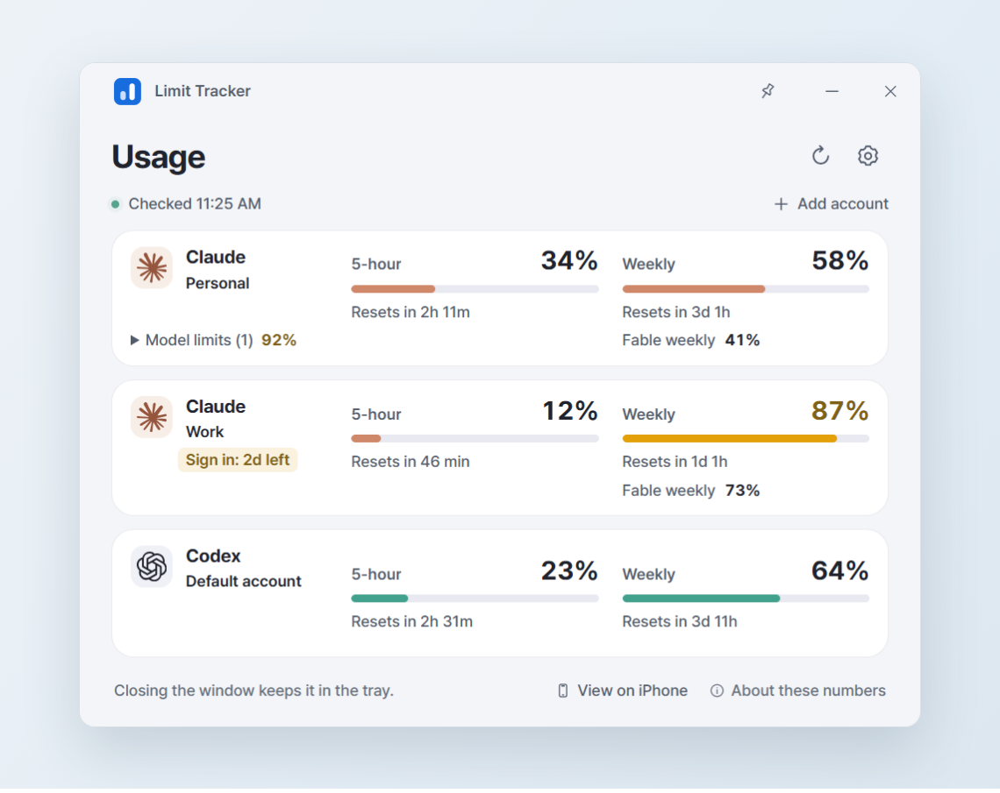
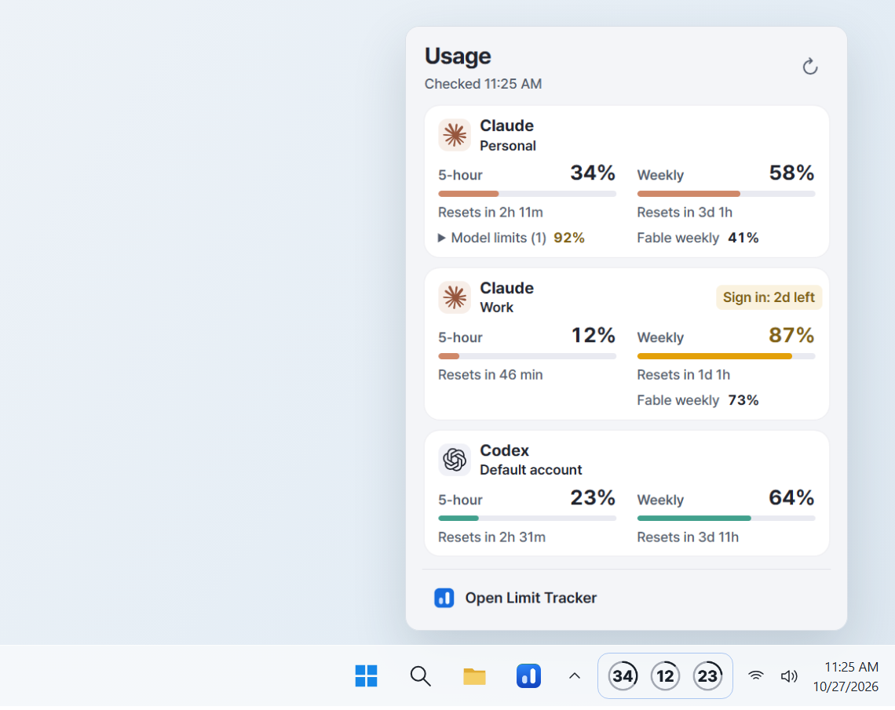
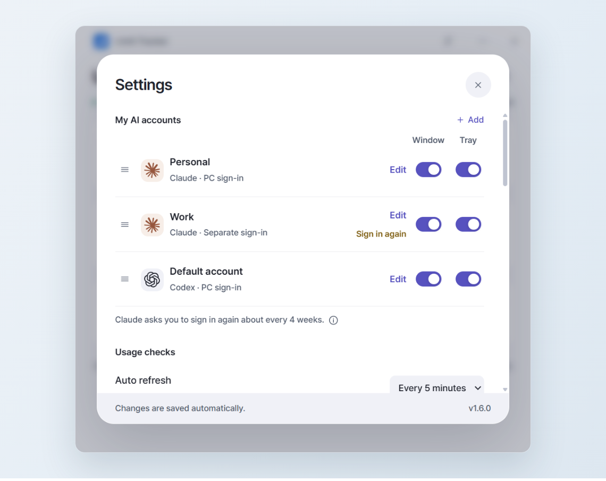
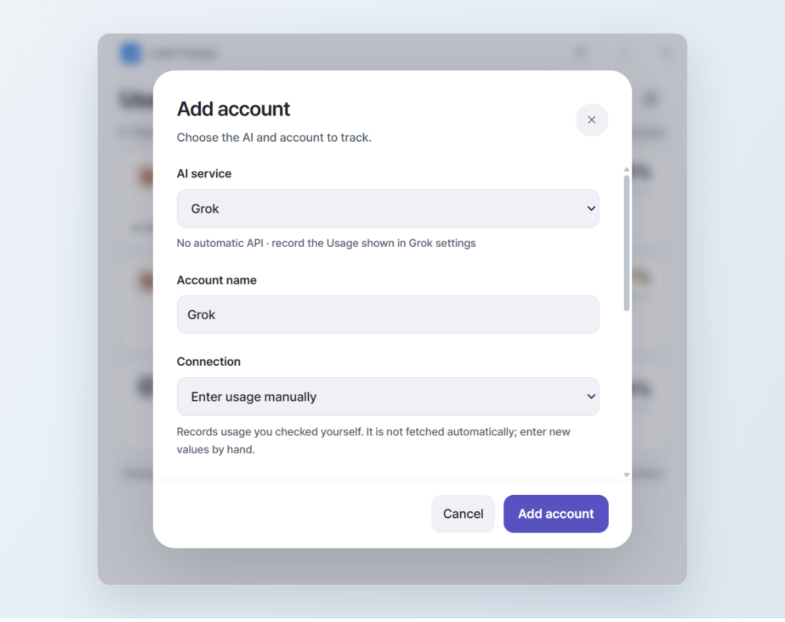
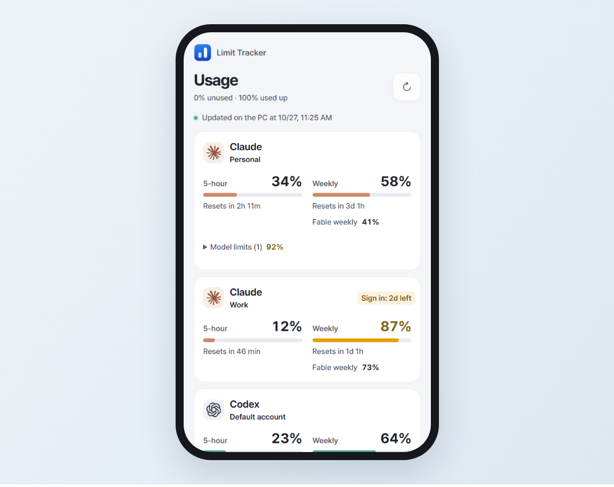
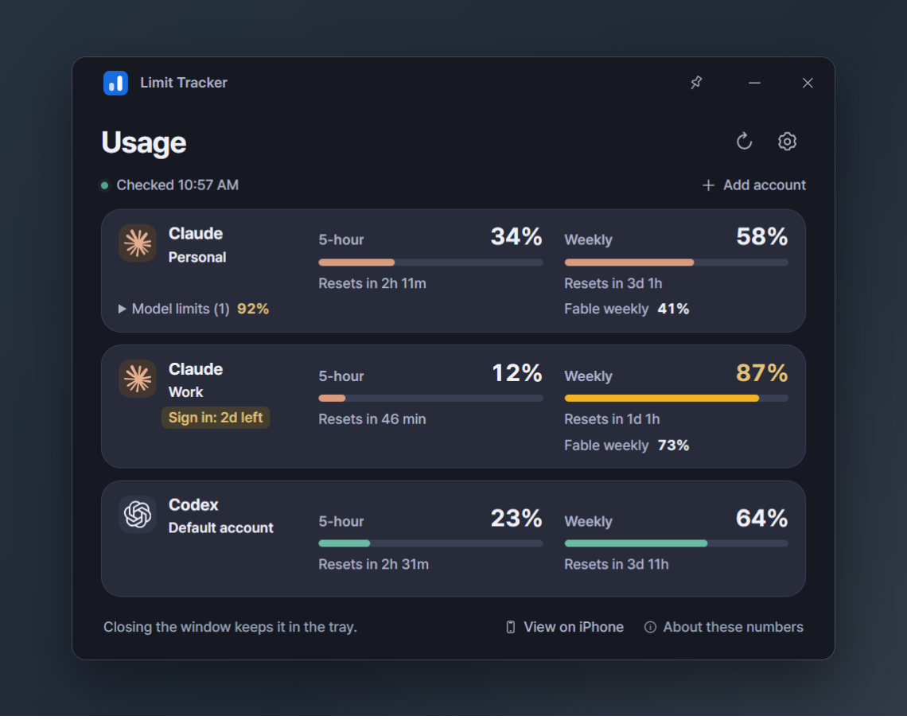

<div align="center">



# Limit Tracker

Your AI usage limits, always in sight.<br>Per-account usage in the Windows taskbar, no click needed.

**English** · [한국어](README.ko.md)

[**Download for Windows**](https://github.com/nowsummer/Limit-Tracker/releases/latest) · [Release notes](https://github.com/nowsummer/Limit-Tracker/releases) · [Security](SECURITY.md)



</div>

## Why

I kept opening usage pages to see how much of my Claude and Codex limits was left. So I put each account's usage in the taskbar.

- **Always in sight** — a usage number and ring for each account in the tray.
- **Every account** — Claude and Codex are tracked automatically, several accounts each. Gemini, Grok or any other AI by manual entry.
- **Heads-up** — notifications at 80% and 95%, and when a limit resets.
- **On your PC** — no server, no sign-up, no analytics. It talks only to the AI services and to GitHub for updates.

## Features

| | |
|---|---|
| **Taskbar** | A usage number and ring per account · pick which accounts get an icon |
| **Main window** | 5-hour and weekly limits side by side · reset countdowns · model limits · Codex credits and usage resets from 80% used |
| **Popup** | Click a tray icon for current and weekly limits · refresh now · open the main window |
| **Notifications** | At 80% and 95% · when a limit resets · a reminder one day before a Claude sign-in expires |
| **iPhone** | Optional read-only page for an iPhone on the same network · add it to the home screen · widget with Scriptable |
| **Everyday** | Drag accounts to reorder · English and Korean · light and dark mode · Start with Windows · always on top |

## Screenshots

<table>
  <tr>
    <td width="50%"></td>
    <td width="50%"></td>
  </tr>
  <tr><td align="center">Main window</td><td align="center">Tray popup</td></tr>
  <tr>
    <td></td>
    <td></td>
  </tr>
  <tr><td align="center">Settings</td><td align="center">Add an account</td></tr>
  <tr>
    <td></td>
    <td></td>
  </tr>
  <tr><td align="center">iPhone</td><td align="center">Dark mode</td></tr>
</table>

<sub>The app windows are real screenshots with example accounts. The desktop, taskbar and phone outline around them are an illustration.</sub>

## Install

1. Download `Limit-Tracker-<version>.exe` from the [latest release](https://github.com/nowsummer/Limit-Tracker/releases/latest) and run it. It installs for your Windows user (no admin rights) and starts the app.
2. On first start, it checks Claude and Codex right away with the Claude Code and Codex sign-ins already on your PC (**Default account**). To stop automatic Claude tracking, delete that Claude account and add it again with **Enter usage manually** ([why](#how-it-works)). **Add account** adds more, with a separate sign-in or manual entry.
3. New versions download on their own. They install only when you choose **Restart now to apply** in Settings → About, or **Install &lt;version&gt; and restart** in the tray menu.

> [!NOTE]
> The installer isn't code-signed, so Windows SmartScreen or Smart App Control may warn about it or block it at first. Windows x64 only.

Uninstalling keeps your settings and separate-account sign-ins. [SECURITY.md](SECURITY.md) lists what to delete to remove everything.

## How it works

- **Claude (unofficial)** — reads the Claude Code sign-in saved on your PC and rewrites that file when it renews the sign-in. Its requests identify themselves as Claude Code. Anthropic's [policy](https://code.claude.com/docs/en/legal-and-compliance) doesn't permit third-party apps to use Free, Pro or Max sign-ins this way and says it may act without notice, so your Claude account could be restricted. A manual Claude account avoids this.
- **Codex** — runs the Codex CLI on your PC through OpenAI's documented [app-server](https://learn.chatgpt.com/docs/app-server). The app doesn't read Codex's login files.
- **Gemini, Grok and others** — manual entry. Gemini is manual only because Google's [Gemini CLI terms](https://www.geminicli.com/docs/resources/tos-privacy) don't allow third-party apps to use its sign-in.

No analytics. Every file, program and network address the app touches is listed in [SECURITY.md](SECURITY.md).

## Build from source

```powershell
git clone https://github.com/nowsummer/Limit-Tracker.git
cd Limit-Tracker
npm ci
npm test
npm start        # run from source
npm run dist     # unsigned installer in dist\
```

Needs Windows x64, Git and Node.js 22.12 or later.

An installed build of your own still downloads new releases from this repository, and installing one replaces your build with the published installer. Turn off **Check for new versions** to stay on your own build.

## License

[MIT](LICENSE). Fonts and service logos keep their own licenses and trademarks ([notices](docs/licenses/THIRD-PARTY.txt), [logos](assets/brands/NOTICE.md)). Limit Tracker isn't affiliated with Anthropic, OpenAI, Google or xAI.

Created by **Jaeha Lee**. Report bugs and ideas in [GitHub Issues](https://github.com/nowsummer/Limit-Tracker/issues); for security problems, see [SECURITY.md](SECURITY.md). Other questions: [limittracker.app@gmail.com](mailto:limittracker.app@gmail.com). Please leave out passwords and tokens.
