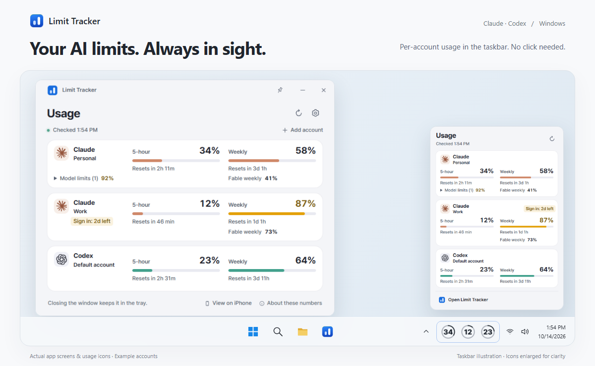
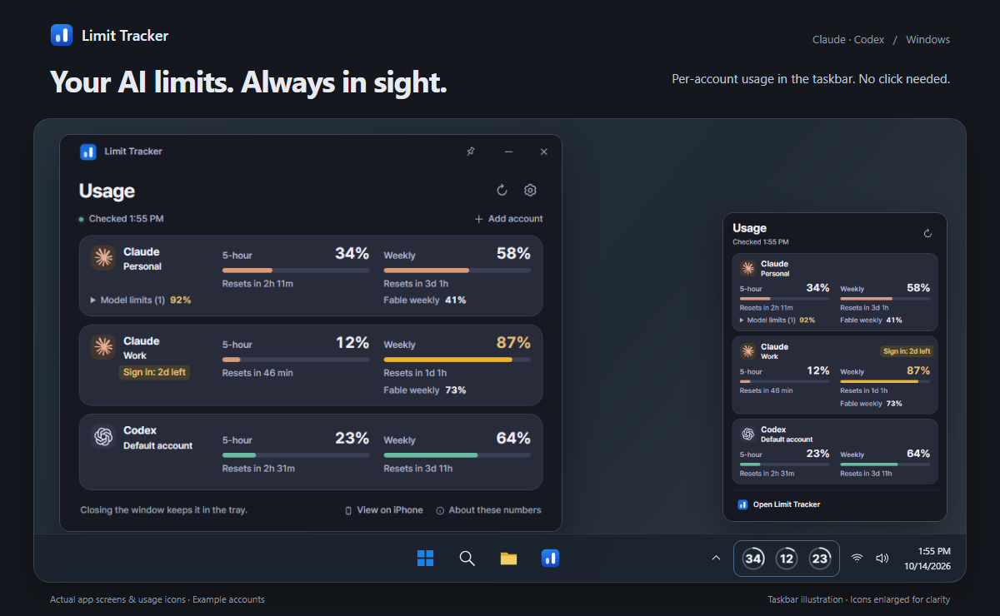

# Limit Tracker

See each account's usage percentage directly in the Windows system tray. No click needed.

**[Download for Windows](https://github.com/nowsummer/Limit-Tracker/releases/latest)** · [Release notes](https://github.com/nowsummer/Limit-Tracker/releases) · [Report an issue](https://github.com/nowsummer/Limit-Tracker/issues) · [Security](SECURITY.md) · [MIT License](LICENSE)



<details>
<summary>View dark theme</summary>



</details>

## Features

- Track Claude and Codex usage automatically across multiple accounts. Record Gemini, Grok, or any other AI manually.
- Show a usage number and circular gauge for each selected account in the system tray.
- See usage percentages and reset times in a compact dashboard and tray popup.
- Get usage and reset notifications. New versions download in the background and install only when you click.
- English and Korean, light and dark themes, and an optional read-only page for an iPhone on the same network.

## Get started

1. Download the EXE from the latest release and open it. It installs for your Windows user and launches the app.
2. Add an account. Automatic tracking uses your own Claude Code or Codex login, so sign in to that CLI first. Manual tracking needs no login.
3. Adjust tray icons, notifications, language, and update checks in Settings.

Your account data is not in the download, so you can share the EXE.

## How it works

The app asks providers only for usage, plan, and reset times. It never sends prompts and never asks for passwords.

- **Claude (unofficial method):** reads the login Claude Code saved on your PC, asks `api.anthropic.com` for usage, and renews that login at `platform.claude.com` when it expires, writing it back to Claude Code's file. Its requests identify themselves as Claude Code. Anthropic's [policy](https://code.claude.com/docs/en/legal-and-compliance) does not permit third-party apps to use Free, Pro, or Max credentials this way and says it may act without notice, so your Claude account could be restricted. Use a manual account to avoid this.
- **Codex:** starts the Codex CLI on your PC through OpenAI's documented [app-server interface](https://learn.chatgpt.com/docs/app-server). The app does not read Codex's login files.
- **Gemini:** manual only from 1.6.0, because Google's [Gemini CLI terms](https://www.geminicli.com/docs/resources/tos-privacy) do not allow third-party apps to use the Gemini CLI login.

There is no analytics or telemetry. Every file, program, and network address the app touches is listed in [SECURITY.md](SECURITY.md).

## Updates

With **Check for new versions** on (the default), the app checks GitHub after starting and every 6 hours and downloads a newer release in the background. It installs only when you choose to: **Restart now to apply** in Settings, or **Install &lt;version&gt; and restart** in the tray menu. Nothing installs at startup, at exit, or on a timer. Copies on 1.5.x still update themselves once more, to 1.6.0 or later.

Installers are not code-signed, so Windows may warn about or block them. Each file on a release page shows a `sha256:` digest; compare it with `Get-FileHash .\Limit-Tracker-<version>.exe -Algorithm SHA256`. A match shows the file is the one on the release page. It does not prove the build came from this source, because builds are not reproducible.

## Source code

The app's code is in this repository under the MIT License, starting with 1.6.0. Fonts and service logos keep their own licenses and trademarks (see [Good to know](#good-to-know)). Releases up to 1.5.6 were published without source.

Build it yourself on Windows x64 with Git and Node.js 22.12 or later:

```powershell
git clone https://github.com/nowsummer/Limit-Tracker.git
cd Limit-Tracker
npm ci
npm test
npm start        # run from source
npm run dist     # unsigned installer in dist\
```

An installed build of your own still downloads new releases from this repository, and choosing to install one replaces your build with the published installer. Turn **Check for new versions** off to stay on your own build.

## Good to know

- Windows x64 only. Claude usage is shared with Claude Code; Codex usage is separate from ordinary ChatGPT chat.
- An independent project, not affiliated with or endorsed by Anthropic, OpenAI, Google, or xAI. Provider changes may break tracking.
- Uninstalling keeps your settings and separate-account logins; [SECURITY.md](SECURITY.md#windows) lists the folders to delete.
- Third-party parts keep their own licenses: see `docs/licenses/THIRD-PARTY.txt`, `src/renderer/fonts/OFL.txt`, and `assets/brands/NOTICE.md`.

Created by **Jaeha Lee**. Report bugs or ideas in [GitHub Issues](https://github.com/nowsummer/Limit-Tracker/issues), and security problems as described in [SECURITY.md](SECURITY.md). Other questions: [limittracker.app@gmail.com](mailto:limittracker.app@gmail.com). Please leave out passwords and login tokens.
